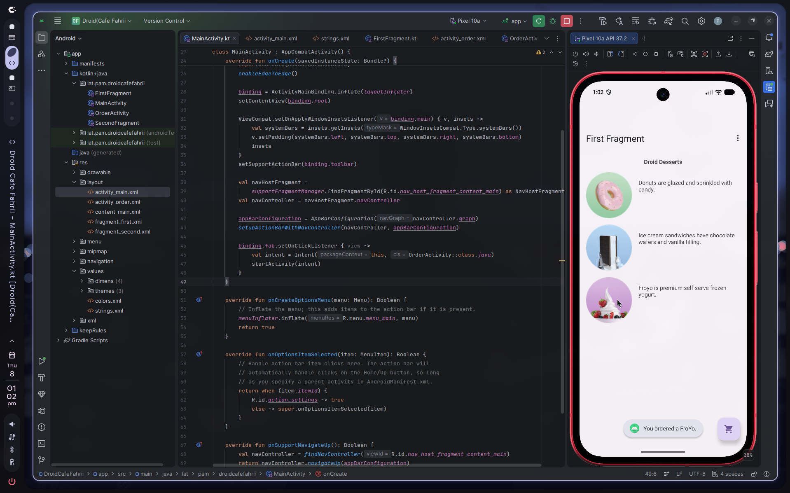
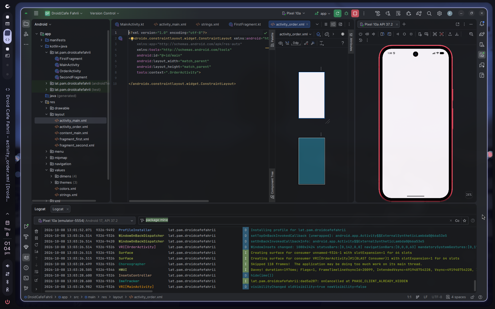
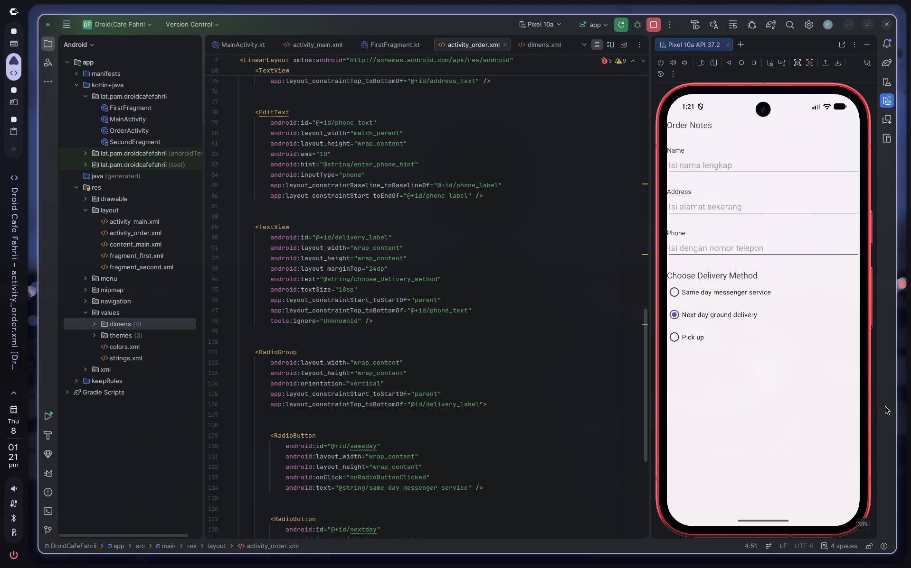
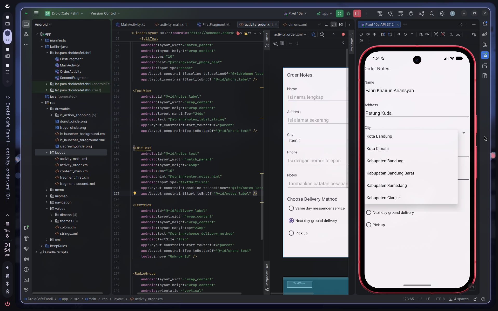

# Pengembangan Aplikasi Mobile - Tugas Pertemuan 5

## Identitas
* **Nama:** Fahri Khairun Ariansyah
* **NIM:** 1247050084
* **Kelas:** A

## Dokumentasi
### Dokumentasi Modul 1: Melakukan implementasi ImageView pada aplikasi Android
* 
* 
### Dokumentasi Modul 2: Menambahkan inputan teks pada aplikasi
* 
### Dokumentasi Tugas: Menambah Notes dan City
* 
* 

